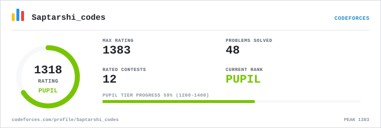
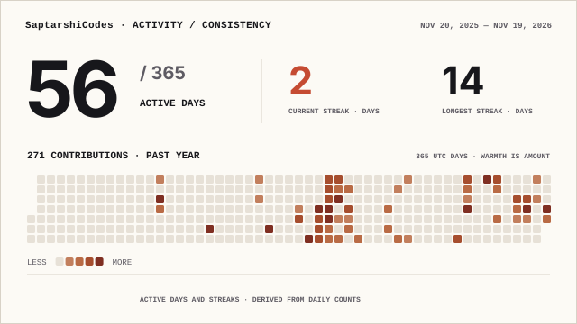
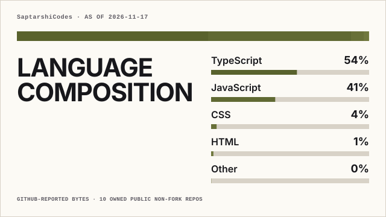

<picture>
  <source media="(prefers-color-scheme: dark)" srcset="./profile/intro-card-dark.svg">
  
</picture>

---

## Tech Stack

| Category | Technologies |
| :--- | :--- |
| **Languages** |  |
| **Frontend** |  |
| **Backend** |  |
| **Databases** |  |
| **Tools** |  |

---

## Competitive Programming

<!-- Regular participant in competitive programming contests across LeetCode, Codeforces, CodeChef, and AtCoder. -->
Regular participant in competitive programming contests across LeetCode, Codeforces, and CodeChef.

### LeetCode
Profile: [leetcode.com/u/saptarshi_codes](https://leetcode.com/u/saptarshi_codes/)

  <picture>
    <source media="(prefers-color-scheme: dark)" srcset="./profile/cp-leetcode-dark.svg">
    
  </picture>

### Codeforces
Profile: [codeforces.com/profile/Saptarshi_codes](https://codeforces.com/profile/Saptarshi_codes)

  <picture>
    <source media="(prefers-color-scheme: dark)" srcset="./profile/cp-codeforces-dark.svg">
    
  </picture>

### CodeChef
Profile: [codechef.com/users/saptarshi010](https://www.codechef.com/users/saptarshi010)

  <picture>
    <source media="(prefers-color-scheme: dark)" srcset="./profile/cp-codechef-dark.svg">
    
  </picture>

<!--
### AtCoder
Profile: [atcoder.jp/users/SaptarshiCodes](https://atcoder.jp/users/SaptarshiCodes)

  <picture>
    <source media="(prefers-color-scheme: dark)" srcset="./profile/cp-atcoder-dark.svg">
    
  </picture>

-->

---

## GitHub Activity

Overview of open-source development, commit cadence, and repository language composition across owned public repositories.

Profile: [github.com/SaptarshiCodes](https://github.com/SaptarshiCodes)

### Yearly Contribution Overview

  <picture>
    <source
      media="(prefers-color-scheme: dark)"
      srcset="./profile/signal-field-v2-wide-dark.svg"
    >
    
  </picture>

### Contribution Consistency & Heatmap

  <picture>
    <source
      media="(prefers-color-scheme: dark)"
      srcset="./profile/activity-consistency-wide-dark.svg"
    >
    
  </picture>

### Language Composition Across Repositories

  <picture>
    <source
      media="(prefers-color-scheme: dark)"
      srcset="./profile/language-composition-wide-dark.svg"
    >
    
  </picture>

---

<h2 align="center">Contact Me</h2>

  I'm always open to discussing new software engineering opportunities, open-source collaborations, or innovative tech projects.  Feel free to reach out through any of the channels below!

  
  &nbsp;
  
  &nbsp;
  
   
  <picture>
    <source media="(prefers-color-scheme: dark)" srcset="./profile/contact-card-dark.svg">
    
  </picture>

