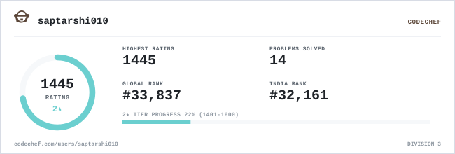
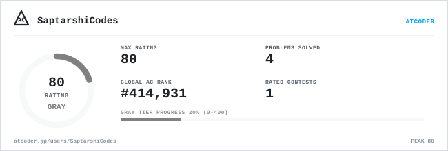
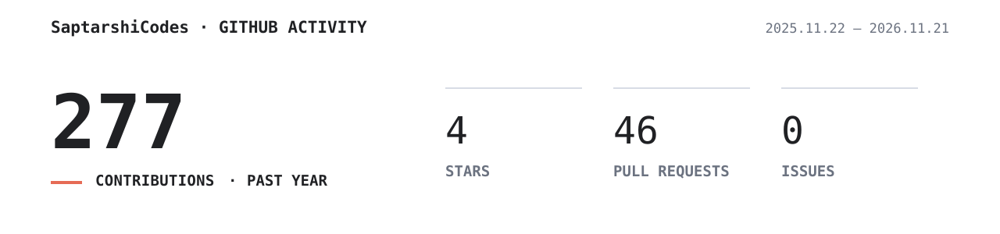

# Saptarshi Manna

Software Developer with a focus on Full-Stack Engineering, Backend Architecture, and Algorithmic Problem Solving.

---

## About

Information Technology undergraduate at Jadavpur University, Kolkata. Focused on full-stack web engineering, scalable client-server architectures, and algorithmic problem solving. Builds web applications and services using TypeScript, JavaScript, Python, C++, and relational and document databases.

---

## Tech Stack

| Category | Technologies |
| :--- | :--- |
| **Languages** |  |
| **Frontend** |  |
| **Backend** |  |
| **Databases** |  |
| **Tools** |  |

---

## Competitive Programming

Regular participant in competitive programming contests across LeetCode, Codeforces, CodeChef, and AtCoder.

### LeetCode
Profile: [leetcode.com/u/saptarshi_codes](https://leetcode.com/u/saptarshi_codes/)

  <picture>
    <source media="(prefers-color-scheme: dark)" srcset="./profile/cp-leetcode-dark.svg">
    
  </picture>

### Codeforces
Profile: [codeforces.com/profile/Saptarshi_codes](https://codeforces.com/profile/Saptarshi_codes)

  <picture>
    <source media="(prefers-color-scheme: dark)" srcset="./profile/cp-codeforces-dark.svg">
    
  </picture>

### CodeChef
Profile: [codechef.com/users/saptarshi010](https://www.codechef.com/users/saptarshi010)

  <picture>
    <source media="(prefers-color-scheme: dark)" srcset="./profile/cp-codechef-dark.svg">
    
  </picture>

### AtCoder
Profile: [atcoder.jp/users/SaptarshiCodes](https://atcoder.jp/users/SaptarshiCodes)

  <picture>
    <source media="(prefers-color-scheme: dark)" srcset="./profile/cp-atcoder-dark.svg">
    
  </picture>

---

## Education

- **Bachelor of Engineering in Information Technology**  
  Jadavpur University, Kolkata, India  
  *WBJEE Rank: 505*

---

## GitHub Activity

  <picture>
    <source
      media="(prefers-color-scheme: dark)"
      srcset="./profile/signal-field-v2-wide-dark.svg"
    >
    
  </picture>

  <picture>
    <source
      media="(prefers-color-scheme: dark)"
      srcset="./profile/activity-consistency-wide-dark.svg"
    >
    
  </picture>

  <picture>
    <source
      media="(prefers-color-scheme: dark)"
      srcset="./profile/language-composition-wide-dark.svg"
    >
    
  </picture>

---

## Contact

  
  
  

